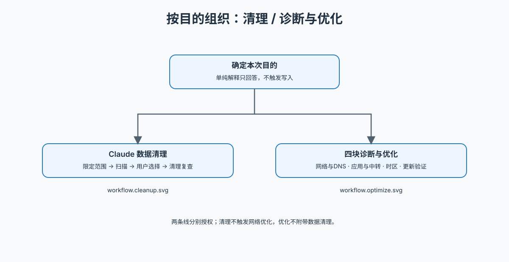

# Clash Network Doctor

按目的选择两条独立线：**清理**，或**诊断与优化**。时区、网络和浏览器环境均归入诊断与优化，不单列第三条线。

先读取 [执行工作流](references/workflow.md)。清理请求按需读取 [清理分支](references/workspace-cleanup.md)，先明确扫描范围，只扫描时交付清单即结束。诊断与优化先记录 https://ipkk.com/claude-ip-check 完整检测分数，列出具体调整项，用户允许后执行获准项，再记录完整后测分数和实际效果。沿用已有具体许可，不将概括请求当作对未知调整项的批准。

Android 操作与订阅更新后重新合并按执行工作流中的 Android 分支进行；使用手机真实浏览器验收，保留原配置和订阅更新限制。

涉及 updater 才读取 [事务接口](references/transaction.md)；涉及环境一致性、字体推断、原生设置或 SSH 方案才读取 [环境与 SSH 参考](references/environment-ssh.md)。Type64/65 按证据检查，不默认屏蔽。分数不代表长期稳定或帐号安全。

下图按目的路由到清理与诊断优化子流程，文本工作流定义执行与停止条件。

