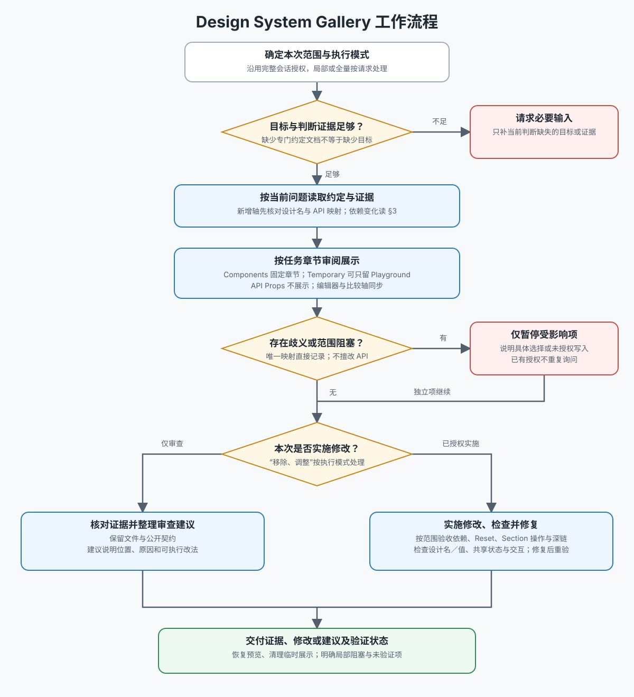

# AW Design System Gallery

目标是让设计系统页面展示与组件内部代码清晰、一致。首次执行读取 [短工作流](references/workflow.md)，本会话已读且仍适用时复用；已有项目事实源和授权继续有效。

取证采用 [源码优先、必要时浏览器复核](references/verification.md#源码优先必要时浏览器复核)，复用已有测试与有效证据，不默认逐组件完整浏览器巡检。

## 按任务读取

最上层先判断本次对象，再进入对应标准：

| 对象／任务 | 读取入口 |
| --- | --- |
| 其他页面：Docs、Styles、Scenario、概览与导航等非组件详情页 | [其他页面标准](references/other-pages.md)，按页面职责和本次改动读取 |
| Components：组件页面及相关开发契约 | [Components 九项标准](references/components.md)，完整校验依次覆盖，局部任务只选对应项 |
| 设计系统校验、组件检查或批量审计的结果汇总 | [统一校验报告](references/audit-report.md)，组件名为首列，固定九项列，编号与表后列表对应 |

一项任务可涉及两类页面，分别应用其标准。专题按需展开，同一规则只在其事实源维护；不要为了填满报告扩大任务或将未验证项记为通过。

