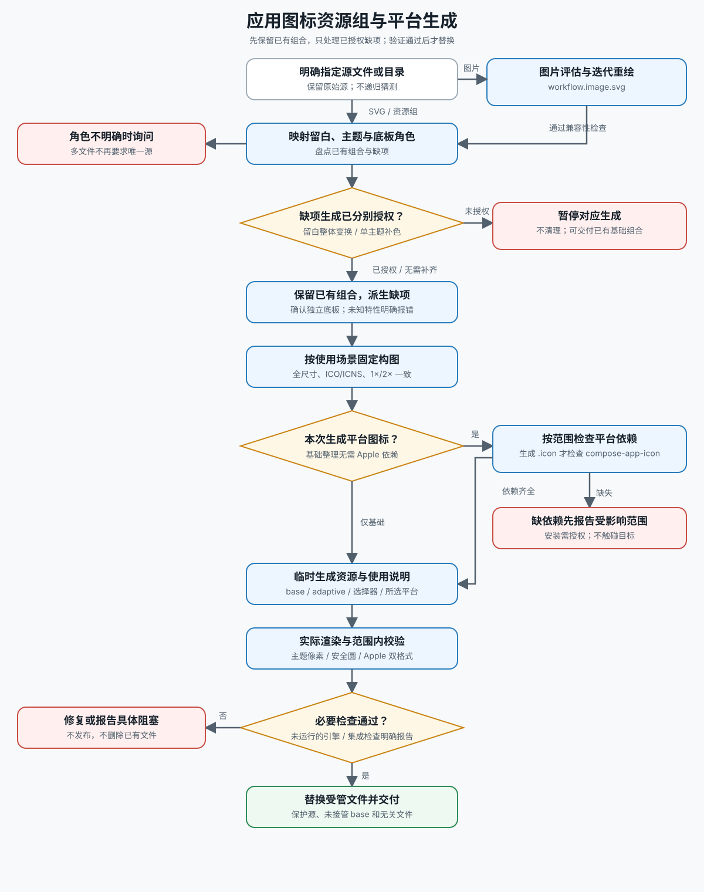

# AW 应用图标资源生成

从用户明确指定的 SVG、多个 SVG 资源组、图片/可读取附件或图标目录整理基础资源并生成平台图标。只检查指定目录根层 SVG，不扫描当前项目猜源；多个文件先映射角色和缺项，不要求选唯一来源。原始源始终保留，不默认覆盖或归档。

执行时读取 [文本工作流](references/workflow.md)，它是决策、授权、停止条件与交付标准的唯一事实源。



## 按任务读取

- 图片入口：先按 [图片转 SVG](references/workflow.md#图片转-svg) 评估，实际查看并迭代重绘；不适合高保真转换时说明损失并取得降级授权。保留原有评估/4 轮对照循环，转换授权不包含留白或补色。脚本仍仅接收 SVG。
- 单 SVG / 资源组：[资源映射与 CLI](references/resource-map.md) 说明角色、缺项、场景配置和授权派生。兼容旧 `--source-svg`；`--source` 可重复或指定目录；非标准多源用 `--source-map` 明确角色，不猜测。
- 基础整理或集成说明：[选择规则](references/selection.md) 包含完整 AI 可执行逻辑、示例、圆角和轮廓责任；同样内容交付在根 README 与 base/README，不能只交选择器。
- 平台生成：读取 [平台产物与验证](references/platform-validation.md)，保留 Apple Schema、Icon Composer 真渲染、ICNS 十尺寸 RGBA 回读、单色模板、不透明商店图和实际前景安全圆检查。

## 必须保持的边界

已有留白与配色直接使用，只处理缺项。新增留白先提出整体等比缩放/平移建议并取得授权，不重画内部造型；单主题补另一主题也单独取得授权。完整会话已存在的同范围许可可沿用。要求生成图标或更新本 Skill 都不隐含两类授权；缺授权不进行相应生成或清理。

确认独立底板后才派生透明版；不确定先问，不能误删标志色块。base 有底版为满幅不透明直角底板；透明版保留主体位置/比例/画布留白。支持分组、rect 和不同 viewBox；不支持的复杂 SVG 明确报告，不能静默损坏。

先为场景选一次构图，再导出全部尺寸、倍率和资源档位。32 逻辑 px 仅新场景默认参考，项目映射及已有选择优先；ICO/ICNS、1×/2× 不按条目切换留白。响应式只缩放；安全区是另一个平台处理，同场景各密度保持一致。

base 保持直角；普通 UI 由容器裁切。平台轮廓可用明确导出配置，但系统/商店负责遮罩时不重复烘焙。已有圆角不是过期理由，不从上轮平台产物继承轮廓；空目录可重建。圆角建议来自项目，不写死品牌 token。

仅检查、基础整理和选择器不要求 compose-app-icon；生成 `.icon` 才检查项目依赖并完整阅读其 SKILL.md，缺失需安装授权。缺依赖准确报告受影响范围，不宣称完成未运行的检查。

所有产物先在临时目录生成和验证，再事务替换受管文件；不先整目录清理。保护输入、base 中未接管文件和无关资源；不修改产品集成代码。通过后直接交付，不能默认停在第一版再求审批。

## 入口示例

```bash
python3 scripts/cook.py --source /absolute/logo.svg --inspect-theme
python3 scripts/cook.py --source-svg /absolute/logo.svg --project-root /absolute/output
python3 scripts/cook.py --source-map /absolute/map.json --project-root /absolute/output --base-only
```

正常交付根 `README.md`、标准库 `select_logo.py`、`base/README.md`、base 固定 SVG 与 `base/adaptive/`，以及所选 `android/`、`iOS&macOS/`、`linux/`、`web/`、`windows/`。完整两留白 × 两主题 × 两底板是 8 固定 + 4 adaptive，但不强制未授权补齐。报告实际缺项、来源、授权、场景映射、校验和真正未验证的集成/引擎范围。
