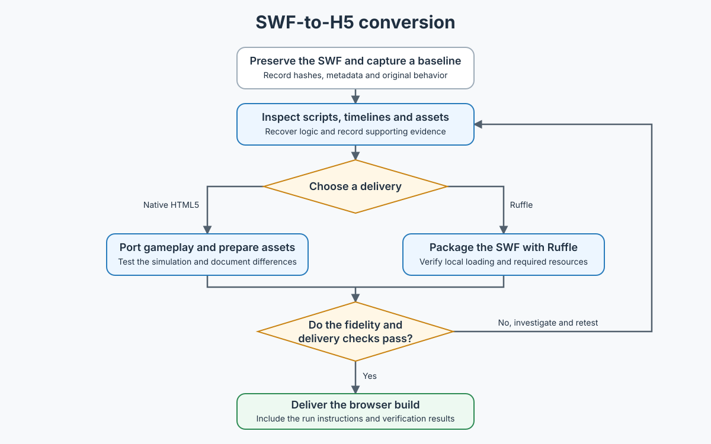

# Convert SWF to H5

Follow the [conversion workflow](references/workflow.md) from source preservation through browser verification. Choose a native port or Ruffle delivery based on recovered evidence and the requested outcome.

